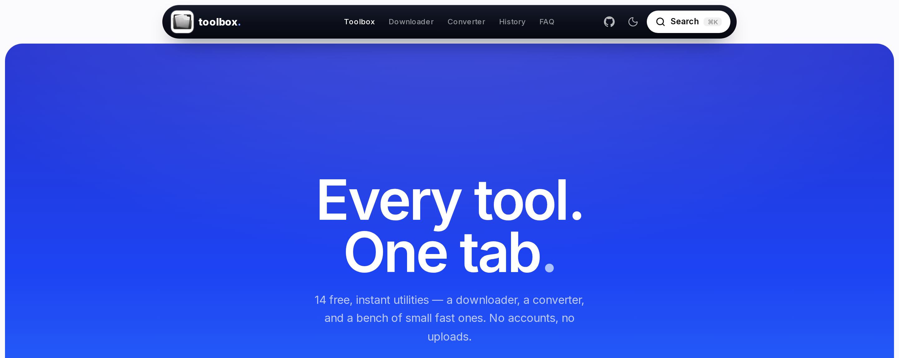

# Toolbox

[](https://github.com/avyuktjs/Toolbox/actions/workflows/ci.yml)
[](https://github.com/avyuktjs/Toolbox/blob/main/LICENSE)
[](https://nextjs.org)
[](https://www.typescriptlang.org)

A growing shelf of free, instant everyday web tools. No accounts, no sign-up — just open and use.



No accounts. Files are deleted after 15 minutes.

> Work in progress — new tools land here regularly. Built by [avyuktjs](https://github.com/avyuktjs) · [vishy.dino.icu](https://vishy.dino.icu/) · [source](https://github.com/avyuktjs/Toolbox)

## What's on the bench

The shelf keeps growing — one utility per route, all free:

| Route | What it does |
| --- | --- |
| `/` | The bench — every tool on one tab, filtered as you type |
| `/downloader` | Paste a link, pick resolution and format (MP4/WebM video, MP3/WAV/AAC audio), keep the file |
| `/convert` | FFmpeg bench for local files — container conversion, audio extraction, custom CRF |
| `/history` | What you've made, kept in your browser only; entries expire when the files do |
| `/json` | Validate / prettify / minify, with the exact position when it breaks |
| `/base64` | Base64 encode/decode, UTF-8 safe |
| `/case-converter` | camelCase → CONSTANT_CASE, copy any row |
| `/word-counter` | Words, characters, sentences, lines, reading time |
| `/uuid` | v4 UUIDs, batch generation |
| `/contrast` | WCAG AA/AAA verdicts for any two colors |
| `/qr` | URLs to PNG, custom colors, three sizes |
| `/url` | Percent-encode / decode |
| `/hash` | SHA-256, SHA-1, SHA-512 of anything |
| `/timestamp` | Epoch ↔ date, both directions, live clock |
| `/diff` | Line diff with no dependencies |
| `/lorem` | Deterministic placeholder text |
| `/mediatools` | MediaTools shelf — the flagship downloader and FFmpeg bench, gathered |
| `/devtools` | DevTools shelf — JSON, regex, JWT, cron, hashes and more, filterable |
| `/imagetools` | ImageTools shelf — crop, compress, redact, PDFs, filterable |
| `/designtools` | DesignTools shelf — gradients, shadows, shade ladders, contrast |
| `/texttools` | TextTools shelf — markdown preview, word counter, case conversion |
| `/image` | PNG ↔ JPEG ↔ WebP — resize, crop and rotate, local always |
| `/crop` | Visual crop — drag the rect, thirds grid, ratio presets incl. passport 35×45 |
| `/redact` | Pixelate, blur or blackout sensitive bits before you post — burned in before export |
| `/compress` | Name a target KB — quality and dimensions get binary-searched until it fits |
| `/exif` | Camera, exposure and GPS metadata — inspect, then strip with one click |
| `/palette` | The 8 dominant colors from any image — median-cut, click to copy |
| `/ascii` | Any image → text characters or a downloadable PNG |
| `/watermark` | Batch text/logo stamps across sets — download as zip |
| `/favicon` | One logo → .ico, every PNG size, webmanifest and head snippet — zipped |
| `/images-to-pdf` | Reorder images, pick a page size — one clean PDF out |
| `/pdf` | Merge, reorder, split, extract page ranges — or rasterize pages to PNG |
| `/regex` | Pattern, flags, live highlights and capture groups — with replace preview |
| `/data-convert` | JSON ↔ YAML ↔ TOML ↔ CSV — round-trip safe |
| `/markdown` | GFM preview, side by side — sanitized, copy the HTML |
| `/jwt` | Header, payload and expiry verdict — decoded locally, never verified |
| `/cron` | `*/15 9-17 * * *` in plain English — plus the next five real run times |
| `/lines` | Sort, dedupe, reverse, shuffle, trim, number any pasted list |
| `/slugify` | Any title → clean URL slug — batch mode included |
| `/password` | Rejection-sampled randomness, honest entropy math, bulk rolls |
| `/chmod` | Toggle rwx bits — octal and symbolic, both directions |
| `/gradient` | Linear, radial and conic — layered stops, pure CSS out |
| `/shadow` | Layered physical shadows, insets and all — copy real CSS |
| `/shades` | One hex → full 50–950 ladder — CSS vars, Tailwind @theme or JSON |
| `/placeholder` | Canvas-rendered placeholders at any size — blueprint grid included |
| `/sites` | The full index of yt-dlp-supported source sites |

## Stack

Next.js 16 · React 19 · TypeScript · Tailwind CSS v4 · yt-dlp · FFmpeg

## Run it locally

```bash
npm install
npm run dev
```

The media tools need `yt-dlp` and `ffmpeg` on your PATH:

```bash
# Debian / Ubuntu
sudo apt install ffmpeg && pipx install yt-dlp
# macOS
brew install ffmpeg yt-dlp
```

## Nitty-gritty

- **Downloading:** server-side yt-dlp; streams come from the source, sizes are reported only when the source says them, no DRM bypassing of any kind.
- **Privacy:** uploads and conversions live in `.toolbox-tmp/` under the project root and are swept after 15 minutes. History is `localStorage` on your device; the server never knows what you did.
- **Limits:** 300 MB per upload, rate-limited per IP (20/min inspect, 10/min convert/download), single-node deploys.

## Contributing

See [CONTRIBUTING.md](./CONTRIBUTING.md) — short version: honest output
only, files are temporary, no accounts, no new deps without a reason.

## License

MIT — see [LICENSE](./LICENSE).
